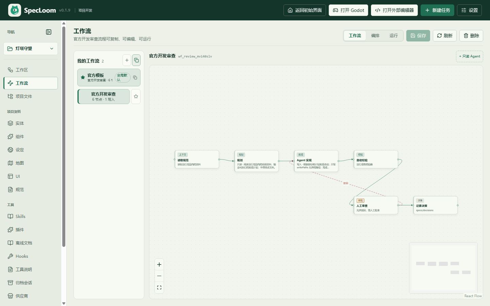
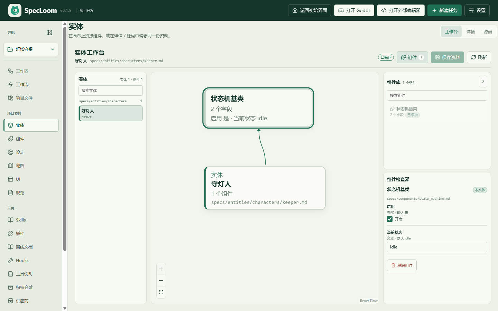
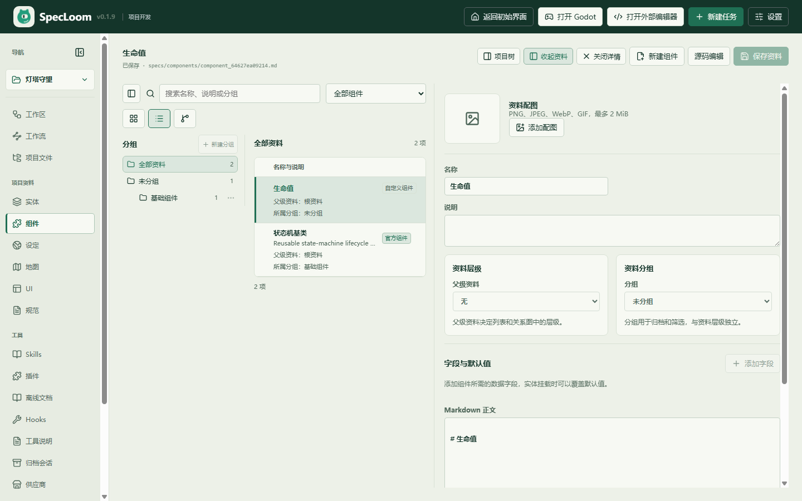

# SpecLoom

[中文](README.md) | **English**

> An agent-native development workspace for game and software projects. Specs, materials, workflows, and approvals live together in one readable, editable, traceable desktop space.

SpecLoom is not just a coding assistant in a chat box. It turns project materials into structured files, turns implementation into a visual workflow, and puts AI changes on a track with scoped paths, validation, and human approval.

## Highlights

### 1. Specs, entities, and components before code

Project rules, entities, components, settings, maps, and UI are stored in the project as Markdown / YAML. The Entity Workbench places the entity at the center and draws connections to its component bindings. Component fields and inheritance are edited in the inspector on the right.

- Search entities and components
- Component library in a collapsible right drawer, hidden by default
- Automatic entity-to-component connections
- Field values, inherited components, and component definitions stay separate
- Components, settings, maps, UI, and specs use a browse-left / read-edit-right layout

### 2. Visual workflows instead of a black-box long task

The Workflow page has three modes: Workflow, Orchestration, and Run.

- The official development-review workflow is the global default; a project can override it
- Workflows are built from read, plan, implement, validate, human review, and decision nodes
- Multiple workflows can run in a sequential orchestration with shared goal, read/write paths, and model
- Step approval supports inherit, always-human, and automatic policies; automatic approvals leave an audit marker
- A failed step pauses the orchestration, then retry resumes from that step

### 3. Q&A and implementation are separate paths

| Mode | Best for | Behavior |
| --- | --- | --- |
| Q&A | Discussion, analysis, research | Normal chat agent; no workflow run |
| Implement | Actually changing the project | Starts the default or selected workflow with scoped paths and approvals |

Task sessions open in implementation mode and reuse the task scope automatically. In a free chat, implementation mode uses a selected task scope or asks for a compact scope card.

### 4. Agents can operate the project, within boundaries

Built-in material tools list, read, create, and update materials, bind components, and set images. Workflow tools list, create, run, and cancel workflows and orchestrations. Writes must stay inside writePaths, saves use version protection, and agents cannot bypass the human approval gate.

Also included:

- Project and global Skills
- MCP tools and project-level extensions
- Godot MCP plugin, editor hand-off, and project media preview
- Session history, context compression, web search, and diagnostics

## Quick start

Requires Node.js 22.12+, npm, and a Windows desktop. The coding toolset uses the host PowerShell by default; Git Bash is configurable. Docker is required only for Godot headless validation and legacy isolated review commands.

~~~powershell
npm install
npm run dev
~~~

The dev launcher picks an available port and opens Electron. Source mode reuses the installed app's user-data directory by default; set SPECLOOM_USER_DATA_DIR to use an isolated debugging profile.

The interface supports Chinese and English. Switch it in **Settings → Appearance → Language**; the choice is stored locally. Core screens are translated first, with remaining pages being filled in.

Verification:

~~~powershell
npm run typecheck
npm test -- --fileParallelism=false
npm run test:e2e
~~~

## Project data

~~~text
specs/
  project.md              project rules
  outline.md              project outline
  entities/               entities and categories
  components/             reusable components
  settings/               settings documents
  maps/                   maps
  ui/                     UI documents
  workflows/              project workflow definitions
  orchestrations/         sequential orchestration definitions
  decisions/              decision records
  prompts/                project prompts
.specloom/
  skills/                 project Skills
  history/                conversation history (never writable by agents)
  workflows/runs/         workflow run records
~~~

Entities and components use front matter for id, parent, inheritance, component bindings, and field values; the body stays Markdown. See the [architecture](docs/architecture.md) and [hierarchical materials design](docs/superpowers/specs/2026-10-06-hierarchical-project-materials-design.md).

## Documentation

- [Architecture](docs/architecture.md)
- [Brand and visual rules](docs/brand.md)
- [Coding tool workset](docs/tool-workset.md)
- [Web search](docs/web-search.md)
- [MCP configuration](docs/mcp.md)
- [Godot MCP plugin](docs/plugins/godot-mcp.md)
- [Default workflow and orchestration design](docs/superpowers/specs/2026-10-18-default-workflow-orchestration-design.md)
- [Chat performance notes](docs/chat-performance-2026-10-08.md)

## License

SpecLoom is licensed under the **GNU Affero General Public License v3.0 only (AGPL-3.0-only)**.

- See [LICENSE](LICENSE) for the full text
- If you modify and distribute the software, you must provide the corresponding source under the AGPL
- Even without distribution, providing a modified version as a network service requires offering its source to users

## Status

v0.1.10, source-development preview. Primarily a Windows desktop app; workflows, orchestrations, the Entity Workbench, and the materials editor are evolving quickly. Issues and PRs with concrete usage scenarios are welcome.

---

[中文 README](README.md)
