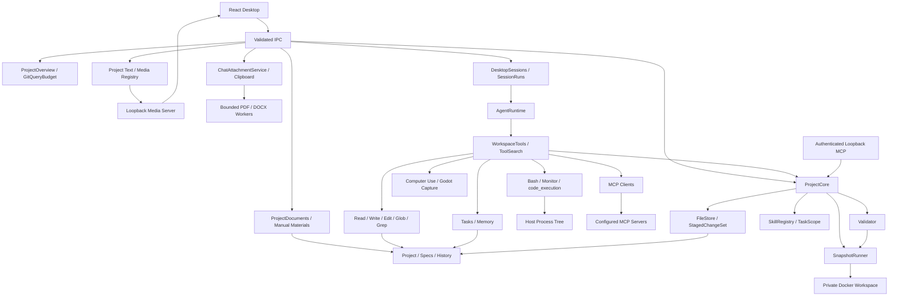

# SpecLoom Architecture

Electron 主进程执行项目操作。`DesktopSessions` 和 `WorkspaceTools` 管理智能体会话与内置工作集，`ProjectCore` 管理规范、实体和旧暂存审查事务。Renderer 只使用受限 preload API；IPC 验证参数、来源窗口、主 frame 和准确的 Renderer URL。模型配置与凭据保存在项目外。

`FileStore` 通过 SHA-256 发现版本，读取使用准确令牌。`WorkFiles` 为每个智能体上下文维护读取回执，Write/Edit 校验当前版本后直接修改项目。旧审查工具使用任务读取凭证和 `ProjectCore` 暂存视图，后续读取和局部补丁面对暂存内容的新版本，同时提交保留真实文件的原始基线。

`StagedChangeSet` 摘要包含 ID、修订、输出与来源依赖。人工批准只绑定该摘要，任何暂存或依赖变化使批准失效。自动任务必须通过同一摘要的验证。提交检查输出、规范、Skills、验证来源和文件目录清单，以捕获外部修改与新增文件。

核心拥有的提交按根目录串行执行，日志先保存意图与前后内容，再进行逐文件版本检查和替换。启动恢复仅恢复仍匹配预期后像的文件；对外部编辑器做出的新修改报告恢复冲突。日志有一致的读写大小限制，并禁止重复变更 ID 覆盖历史。

智能体在初始目标、完整工具批次和最终回复处保存已脱敏的会话检查点。检查点按完整批次截取并受消息数与总大小限制。重启恢复上下文用于继续任务和历史展示，读取凭证、人工批准与活动草稿验证授权始终重新取得。

会话统一使用提示词组装器：内置工作规则、全局 `customInstructions`、项目 `specs/prompts/system-prompt.md`、只读项目事实和能力清单。每次运行重新读取项目文件，旧系统消息不从会话历史恢复。WorkspaceTools 按文件、进程、待办/记忆、MCP、桌面输入和引擎插件拆分；工作会话直接提供编码能力。原有 TaskScope 仍管理暂存审查事务，不再作为聊天解锁开关。

项目提示词通过专用、可信桌面 IPC 读取和保存，不通过智能体工具或 MCP 创建额外授权。接口携带项目路径及保存时的 SHA-256 版本，拒绝旧项目请求和外部编辑冲突。文件限制为 16,000 字符，读取与保存复用 `FileStore` 的路径策略并拒绝符号链接和目录联接。首次创建将同步后的临时文件通过独占硬链接原子发布，已有文件使用版本保护的原子替换，失败清理临时文件。设置页保留失败草稿并忽略切换项目前的异步结果。

Skills 是 Markdown/YAML 流程模块，Skill 工具返回项目工作流的真实正文和引用内容。工作集支持标准 name/description 元数据；旧 SkillRegistry 与 TaskScope 继续管理暂存审查的来源及权限。用户可以直接编辑规范和 Skills；下次操作读取最新版本。

## 0.1.8 项目概览与桌面体验

近期项目对有效和失效路径均提供移除入口，只删除历史条目，项目目录仍可重新打开。独立 `AboutView` 通过 `projectOverview.read` 获取 Git、README 与根 `.gitignore` 的真实状态，并展示 SpecLoom 名称、package 版本和作者。Git 查询独立于高频工作区 `state()`，使用固定参数和 `shell:false`；单命令最长 5 秒、整次检查最长 10 秒、输出合计 2 MiB，清除继承的 `GIT_*` 覆盖。结果区分未安装、非仓库、普通仓库、linked worktree、上级仓库、bare 与读取失败；远程 URL 在主进程脱敏，原始 stderr 不进入 IPC 或模型上下文。

主聊天、兼容聊天和旧任务入口从同一概览服务注入有界项目事实，并明确标记仓库内容为不可信数据。主会话在首次实际交流确认非仓库时建议初始化；初始化、编写 README/ignore、分支和推送仍使用原有工具和审批，不因概览读取获得额外权限。About 只在激活、刷新或窗口聚焦时查询，切换项目丢弃旧响应。

项目文件页的“隐藏 .import 文件”默认关闭，按规范项目路径保存在本机；树、资料补入条目和资源列表共同按文件名后缀过滤，保留既有 Godot `.uid` 规则。隐藏当前只读文件会关闭预览，不修改文件。聊天 composer 使用独立样式和 `rows=1`，共用 44–160px 自动高度变量，创建中草稿与宽度变化也重新测量；消息区高度和窄窗口控件可达性由源码窗口测试验证。

## 0.1.9 侧栏项目信息

`ProjectSidebarInfo` 在导航内显示当前项目名，展开后显示路径、引擎版本、渲染方式和主场景。主内容区不再保留独立 `project-bar`；收起导航时仍提供可访问的项目信息入口，点击后展开导航和详情。详情随项目路径切换重置，长路径换行，窄窗口使用现有导航抽屉。

## 项目文件预览与媒体授权

`projectTree()` 只枚举路径；普通资源不进入资料 Markdown 清单，也不预先计算整文件摘要。选中文本后由同一 fd 有界读取、严格 UTF-8 解码并计算版本，上限 1 MiB。资料继续使用已有可编辑 API 与草稿保护，普通文本只读。图片、音频和视频通过 `ProjectMediaRegistry` 获取临时 lease，Renderer 使用原生 `img`、`audio`、`video`，支持图片缩放、音视频 controls/seek 和视频展开/全屏；实际解码能力由 Electron 决定，失败有可见提示，不自动转码或播放。

媒体服务监听随机 `127.0.0.1` 端口，以 32 字节随机 token 绑定单文件与可信窗口 owner；URL 不持久化、不用于模型输入。HTTP 精确校验 Host，仅支持 GET/HEAD、单 Range、206/416，不开放任意 CORS。路径复用项目策略，拒绝越界、UNC、ADS、符号链接/junction 和保留运行目录；选中时只嗅探有界文件头，图片上限 32 MiB，大音视频通过已验证 fd 流式传输并施加背压。请求和流块检查文件 generation，替换或删除使旧 lease 失效。每个 owner 最多 4 个 lease，服务合计最多 8 个活动流。

切换文件、项目、页面隐藏或卸载时，Renderer 暂停播放器、移除 src、调用 load 并释放 lease；迟到打开结果也释放。主进程在窗口关闭、崩溃或非可信导航时撤销 owner，异步资源读取完成后再次检查 owner 世代与当前项目。Hub 共享服务按具体 FileStore 保存媒体后端，A 窗口的释放或项目切换不撤销 B 窗口授权；最后后端退出关闭端口与活动流。

## 聊天附件与原生剪贴板

文件选择、键盘粘贴与右键粘贴共用 `AttachmentIngest`。操作同步捕获目标会话或本地 creationToken、草稿修订和选区，按原逻辑目标提交；创建后迁移到真实会话再准备。切会话保留原队列，删除、归档、项目切换或窗口撤销时取消并丢弃迟到结果。等待粘贴时的新输入保留，已知粘贴 splice 会更新后续锚点；提交失败恢复原正文和附件，同时保留后来输入。托盘提供预览、文档提取正文、限制说明、逐项错误和移除操作，未准备完成时禁止发送。

可信 IPC 只接受受限 Uint8Array、项目/会话/requestId，不接受源文件路径；在通用 JSON 限额之前检查实际字节。每批最多 16 项、原始合计 16 MiB，合成消息最多 131072 字符。PNG/JPEG/WebP/GIF 按实际签名识别，单图 2 MiB，继续使用既有 vision 载荷；无看图能力的模型会保留草稿并提示。已识别 UTF-8 文本单文件 64 KiB，文档正文进入消息及引导队列，临时图片字节不建立永久历史仓库。

PDF/DOCX 单文件最多 6 MiB，由 `ChatAttachmentService` 在可终止 Worker 解析：最多 2 并发、16 排队、全局待处理原始字节 16 MiB、每个 Worker 128 MiB old-generation heap 和 10 秒解析超时。PDF 最多提取 20 页、64 KiB 正文，保留页码和截断说明；扫描件无 OCR，密码和损坏分别报错。DOCX 使用直接依赖 yauzl/saxes 惰性读取 `word/document.xml`，最多 2048 个 ZIP 条目、声明解压合计 32 MiB、实际 XML 8 MiB、XML 深度 128、正文 64 KiB；拒绝加密、重复目标、越界条目及 DTD/外部实体。取消实际终止 Worker，终止完成后才复用并发槽。源码临时运行、桌面编译和 Hub 资源准备均生成 `chat-attachment-worker.cjs`；Hub Worker 自带 ZIP/XML 依赖，并从模块内 PDF.js 资源加载 PDF 支持。

原生剪贴板只在显式粘贴时读取。DOM File 优先；主进程识别 FileNameW，以及 Electron 在 Windows 将其归一化后的 `text/uri-list`。后者先探测原 FileNameW，再严格解析显式本地 `file:` URI；普通文本不猜路径。原生回退只读取第一个经过普通文件、路径、链接和大小检查的本地文件，并在多文件表示时说明范围；无文件表示才读取截图或文本。无效文件表示直接报错，不退成文档缩略图或路径文字。截图在 PNG 编码前检查空图和 1600 万像素上限，编码后检查 2 MiB。

## 分层资料与组件

项目资料以 Markdown/YAML 文件为事实来源。实体与分类资料保存于 `specs/entities/**/<id>.md`，组件定义保存于 `specs/components/<id>.md`，设定、地图和 UI 使用各自目录。分类节点是实际资料，`parent` 只能引用同类资料的真实 ID 或路径；树结构由索引反向建立，不存储 `children`，也不依赖物理目录深度。`extends` 表示单个实体原型，`relations` 表示普通实体关联。

组件通过 `fields` 定义字段名、可选显示名称、`number`/`string`/`boolean` 类型及匹配的 `default`。实体通过 `components: [{ id, values }]` 挂载组件，值仅能覆盖定义中的字段。Renderer 沿继承链展示组件及实例值：组件默认值作为基础，基实体到派生实体逐层覆盖，当前实体的显式值优先。组件定义本身不运行游戏逻辑；引擎代码生成仍读取实体与组件事实文件并由项目工作流实现。

`DocumentsView` 负责读取目录、资料选择、页面切换与草稿，`materials-model` 从 front matter 派生目录和关系树，`MaterialDetails` 提供父级、继承、组件实例值及组件字段的结构化编辑。`project-materials` 使用唯一 YAML 键与受限别名解析，编辑保留未知 front matter 字段及完整 Markdown 正文，解析失败时保留源码编辑入口。

实体和组件使用名称创建，自动分配安全 ID，并立即保存到项目文件。`ProjectDocuments` 负责页面与智能体的 Markdown 保存和图片资产，复用 `FileStore` 的路径保护、项目锁和版本令牌；不依赖智能体任务、模型或会话。IPC 的保存与配图接口显式绑定当前项目路径。保存只扫描规范目录，检查字段并拒绝本次引入的引用错误；前序无关错误不阻断编辑。

`specs/project.md` 的 `materialGroups` 保存按资料类别隔离的分组树；每个节点有稳定 ID、父组 ID、名称和顺序，空分组也能持久化。资料 front matter 使用 `groupId`，由共享摘要解析完整 `groupPath`；旧 `group` 文本按类别导入根组，项目登记表迁移完成后，资料首次保存时再替换为 ID，不批量改写旧资料。ProjectDocuments 在项目锁与版本令牌内校验登记表和类别归属，分组树变更只写项目概览，不改变资料路径、`parent` 或 `extends`。

`MaterialExplorer` 提供各资料页共用的左侧层级树、关键词搜索和网格／列表展示；选父组时包含后代，实体页的类型筛选与分组和关键词取交集，组件来源筛选仍独立。空组可维护、重命名与移动保留组 ID，只有无资料且无子组的叶节点可删除。`MaterialDetails` 用层级选择器编辑归属。`MaterialImage` 负责上传与安全预览；图片按内容 SHA-256 保存为 `assets/specloom/materials/<摘要>.<扩展名>`，去重并校验实际图片类型、大小和摘要。`DocumentsView` 直接调用专用资料 API，`App` 不再把保存接到任务暂存或切换工作区。

App 仍持有未保存的编辑缓冲，切换页面保留，有修改时保护退出，切换项目确认丢弃。创建成功的资料已经持久化；只有后续未点击“保存资料”的编辑是内存缓冲。智能体继续按需读取同一份项目资料文件，现有代码审查任务保持独立流程。

`WorkMaterials` 提供智能体资料查询、结构化创建与更新、组件绑定及配图；`MaterialsList` 返回含空节点的 `groupTree`、稳定 `groupId` 与完整路径，按父组 ID 查询包含后代，并支持实体类型筛选。新建与更新使用同一类别树校验，旧 `group` 文本查询仍兼容；`material-tool-catalog` 独立定义有界参数，查询与读取初始可用，修改工具通过 ToolSearch 加载。共享 `material-catalog` 为页面和工具提供相同分类与摘要。所有已有资料写入要求明确版本，通用 Write/Edit 的 specs Markdown 写入也进入 ProjectDocuments。组件绑定合并默认值和已有值，并解析 ID、路径及 res:// 引用，避免重复挂载。

实体可选 `stateMachine` 配置由共享 `StateMachineSchema` 约束，包含初始状态、有限状态列表和事件转换。状态 ID、转换端点与同一来源事件的唯一性在页面保存、智能体资料工具和 Markdown 验证器中使用同一规则；配置只允许实体，状态机基类组件由项目初始化按缺失写入 `specs/components/state_machine.md`，不会覆盖用户编辑。Renderer 的 `StateMachineEditor` 负责状态/转换表单操作和引用同步，SpecLoom 只保存描述，不执行游戏状态机。

ProjectDocuments 成功保存后发布含项目路径、文件路径和版本的变更事件。可信 IPC 只推送当前项目事件，preload 订阅由 DocumentsView 清理；浏览器和无修改的编辑器立即重新读取，本地草稿保留原始版本，保存时仍检查冲突。preload 以可克隆的错误记录传递拒绝结果，保留 code/details，避免 contextBridge 克隆 Error 时丢失冲突恢复信息；共享 error-message 提取原生 Error 与桥接错误记录的消息，供页面统一展示。

Markdown 验证器检查资料类型与布局、字段定义、有限数值和默认值类型；引用验证器检查真实父级、单继承、目标类别与版本、父级/继承环、重复挂载及实例字段和值。界面选择器排除自身及会造成关系环的对象。在详情编辑中，已被实体挂载的组件原有字段不能直接改名、改类型或删除；组件可增加字段、修改显示名称与默认值。结构化编辑等资料读取完成后启用，字段重名与保留键由表单阻止。源码编辑保留人工审查语义，完整校验通过审查页“验证”执行，人工批准不代表验证通过。完整契约见 [分层资料与组件设计](superpowers/specs/2026-10-06-hierarchical-project-materials-design.md)。

内置 Bash、Monitor、code_execution 在当前项目运行宿主进程，进程管理器负责超时、取消、输出与进程树回收。Windows 通过受控 PowerShell 宿主创建内核 Job Object，目标进程在 suspended 状态加入 Job 后才恢复，`KILL_ON_JOB_CLOSE` 保留子孙进程所有权，包括父 shell 已退出的情况。停止只面向本会话拥有的作业，等待与终止有超时；无法确认退出时保留真实状态并拒绝重启，不按进程名或端口批量结束外部实例。旧审查 `bash.exec` 挂载私有快照，命令退出后收集文本差异，返回待审变更。其二进制资源可以被复制和读取，文本变更工具不能改写二进制。快照拒绝符号链接、特殊文件、越权输出和超限数据。超时、取消或输出超限会移除容器；移除失败保留快照并报告。

Windows supervisor 明确设置 Console.InputEncoding、Console.OutputEncoding 和 `$OutputEncoding` 为 UTF-8，Node 发送的启动 JSON 因此保留中文路径与参数。用户 PowerShell 命令编码为 UTF-16LE/base64 数据，在 ASCII `-Command` 包装内作为独立 ScriptBlock 解析，保留脚本首部 using/param、文本错误输出与退出码；cmd 先切换至代码页 65001，参数包装遵守 cmd `/c` 的命令规则。宿主在 stdout/stderr 首部发送随机握手标识和系统 ANSI 代码页，`process-output-decoder` 按最多 8192 字节的记录优先严格解码 UTF-8，必要时回退系统代码页，并保留跨 chunk 的多字节序列及结束时刷新。没有换行的内容以100ms有界延迟提供可更新的 partialOutput 临时快照和带说明的进度片段；正式 output/cursor 仍仅追加记录，在换行、记录上限或进程结束时提交，原始 data 到达仍更新 Monitor 活性。同一记录混合编码或字节含义有歧义时无法可靠推断；已持久化的替换字符不能恢复。启动诊断从真实 Win32Exception 取得 NativeErrorCode，JSON 解析的字符位置不作为系统错误码。编码适配不改变 Job Object 的所有权和停止/重启规则。

快照注册表位于容器挂载之外的 `.specloom/runtime/`。创建快照与容器前先持久登记所有者及资源身份。再次打开项目时仅回收已确认死亡所有者的资源；核对目录边界、容器标签和记录版本，独占认领回收，失败则保留记录并将诊断显示到桌面。

旧 Godot 验证使用隔离快照，因为导入过程可能执行脚本或编辑器插件。旧 Bash 容器上限为 512 MiB/64 进程，Godot 验证容器为 1536 MiB/128 进程；均禁网、限制一个 CPU、丢弃 capabilities、启用 no-new-privileges。新游戏截图插件通过当前项目自动加载节点捕获运行游戏的 Viewport，独立于该容器验证流程。

入站 MCP 使用官方 SDK 的无状态 Streamable HTTP，随机端口监听 `127.0.0.1`，通过 Bearer 令牌认证，检查 Host/Origin，并限制请求大小和并发。每个入站工具调用指定桌面已确认的任务 ID。出站客户端则读取项目 MCP 配置，连接 stdio/Streamable HTTP 服务器，按需加载并执行其真实工具。

## 会话与流式交互

DesktopSessions 在项目内部的 .specloom/history/sessions/ 保存原子 JSON 会话记录；无项目的 API 会话保存于本机 userData/conversations。任务、会话与运行分离，taskId 仅由可信创建接口绑定；IPC patch 和导入不能修改任务授权。并发迁移在存储队列中去重，删除任务聊天保存迁移标记，避免刷新或重启后重新出现。记录及 JSON 导入上限为 4MiB，会话最多 256 个；模型上下文另有完整工具批次和消息预算约束。

SessionRuns 为各会话保留独立 runId、AbortController、事件序号和等待点。可信主窗口的 preload 订阅只接收当前项目事件，Renderer 使用记录修订过滤过期快照，离开工作区后后台状态仍能更新。文字、工具和问题具有稳定 ID；相同工具参数接收、执行及结果更新同一卡片。

Stop 将运行等待与 AbortSignal 竞争，即使第三方 executor 或继承管道永不结束，也能先持久保存 cancelled 状态并释放运行占用。旧运行的事件、上下文、用量、问题、能力写入及异步模型/工具准备均检查 runId 和信号；迟到清理不能覆盖下一轮的权限回调。Monitor 默认增量读取，list 显示本会话所有权，restart 要求原 id、完全相同的 command/shell 和正常命令审批。连续 3 次无变化先建议较长等待；同一作业和状态连续至少 5 次且实际无进展达到 120 秒才结束运行中作业的重复轮询，已结束、状态未知或明确实例冲突可更早结束。真实进展、状态/作业切换和其他工作重置预算；结束只报告当前状态，不自动杀掉仍运行的后台进程，并在最终边界消费已接收的引导。

会话起始能力快照来自真实 Skill 文件和 MCP listTools，ToolSearch 管理本轮加载的参数定义；MCP 各服务器独立连接，失败不移除内置工具。子智能体独立模型上下文与文件读取回执，子调用使用唯一 ID 进入父会话时间线。进程管理器拥有后台任务与进程树，停止和退出时清理；输出同时进入进度事件和 Monitor 增量读取。

新建、导入和列表读取在会话记录可用时立即返回；能力扫描独立在后台运行，通过带修订号的会话事件更新清单。输入框不等待 Skill、MCP 或插件扫描，创建后自动聚焦；扫描失败单独显示诊断，保留可编辑草稿。发送消息前取消并收拢未完成的起始扫描，再重新发现当前能力，避免并发扫描破坏 MCP 连接；删除会话和退出也会取消并回收扫描资源。

思考摘要从三个模型协议单独解析，Renderer 显示供应商实际返回的文本和动画状态；不会生成伪造思考内容。`ToolChainBox` 即使在隐藏详情时也保留最近三条记录、最新实际思考片段和最多两个进行中工具；完整记录和参数/输出仍可按需展开。工具预览只消费已验证参数，识别真实事件的结果包装，有界显示用途、路径或命令、状态、简短结果和成功编辑片段；未知工具不默认展开原始输出。完整过程列表仅在用户接近底部时跟随，向上阅读时提供最新步骤入口。每轮工具统计按普通用户消息边界保留，引导消息沿用正在运行的轮次。图片工具结果进入 vision 消息，不占文本字节预算；持久检查点只保存图像调用记录。头像数据限制为有签名验证的 PNG/JPEG/WebP，智能体默认使用品牌资源。

`SessionRuns` 在每轮前后调用 `RunFileChangeTracker`，以内容 SHA-256 比较新增、修改与删除，不依赖 Git，运行前的脏工作区即基线。默认扫描预算为每次 600ms、4000 文件、12000 目录项、32MiB 总内容和 2MiB 单文件，取消阶段约 80ms；不跟随链接，跳过内部、依赖与构建目录。扫描复用同一 Read 审批策略，需审批的敏感文件不提前读取；直接 Write/Edit 的目标在工具成功及内容变化均可核对时标记为 `tool`，需审批的目标只有原审批通过后才捕获工具前值，再恢复工具执行。其他比较所得变化标记为 `workspace`，仅表示期间观测，不将用户或其他程序的修改归为智能体作者。失败、取消保留已确认内容，无变化、回退到基线或失败编辑不虚报。

可选的 `ChatItem.fileChanges` 保存 runId、文件路径、增删改类型、来源、完整性和覆盖说明，旧会话缺少该字段仍可读。报告最多 256 项、48KiB，并按会话实际剩余容量裁剪；通常挂在本轮最后的 assistant 回复，无回复时创建空正文回复，极满会话可挂在原用户消息并由 Renderer 放至轮末展示。`FileChangesSummary` 默认显示八项，更多可展开，空报告及覆盖受限均有明确提示。报告不保存文件正文，不提供完整差异或回滚；项目外命令效果、缺失子工具事件和扫描/持久化上限可能使清单不完整，不能承诺全量无漏。

protocol-stream 使用增量 UTF-8 和 SSE 帧解码，按工具索引累计原始参数，拒绝未结束的工具流及无效 JSON。流中仅保留可能形成凭据的后缀，跨文本片段与工具边界脱敏；不完整参数只发布字符数进度。取消会终止挂起的响应读取，已保存文本仍可重启回看。

ask_user 的问题身份由主进程生成，模型只能给出字段契约。回答验证会话、运行、问题身份及字段选项；同一答案幂等，不同并发答案不能覆盖先保存的答案。提交失败保留卡片，关闭仅表示稍后处理。历史问题不会伪造恢复后的活动等待点。既有差异批准、版本令牌、TaskScope 与 MCP 权限边界仍由 ProjectCore 管理。
