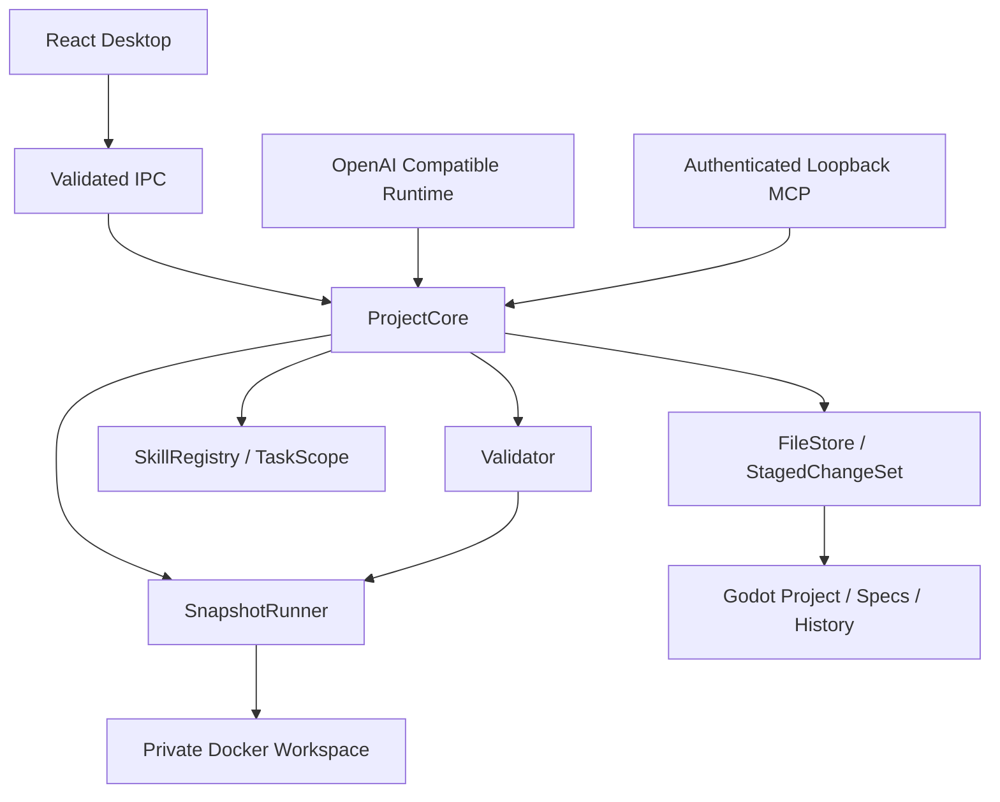

# SpecLoom Architecture

Electron 主进程中的 `ProjectCore` 是项目操作权威。Renderer 只使用受限 preload API；IPC 验证参数、来源窗口、主 frame 和准确的 Renderer URL。模型配置与凭据由项目外的 `ModelVault` 管理。

`FileStore` 通过 SHA-256 发现版本，读取必须带准确令牌。现有文件的修改还需要任务读取凭证。`ProjectCore` 维护暂存视图，后续读取和局部补丁面对暂存内容的新版本，同时提交保留真实文件的原始基线。

`StagedChangeSet` 摘要包含 ID、修订、输出与来源依赖。人工批准只绑定该摘要，任何暂存或依赖变化使批准失效。自动任务必须通过同一摘要的验证。提交检查输出、规范、Skills、验证来源和文件目录清单，以捕获外部修改与新增文件。

核心拥有的提交按根目录串行执行，日志先保存意图与前后内容，再进行逐文件版本检查和替换。启动恢复仅恢复仍匹配预期后像的文件；对外部编辑器做出的新修改报告恢复冲突。日志有一致的读写大小限制，并禁止重复变更 ID 覆盖历史。

智能体在初始目标、完整工具批次和最终回复处保存已脱敏的会话检查点。检查点按完整批次截取并受消息数与总大小限制。重启恢复上下文用于继续任务和历史展示，读取凭证、人工批准与活动草稿验证授权始终重新取得。

Skills 是 Markdown/YAML 流程模块，加载时由受约束文件接口读取引用，记录实际来源版本。Skill 的指令不能扩大任务权限。用户可以直接编辑规范和 Skills；下次操作须读取最新版本。

Bash 只挂载私有快照，命令退出后收集文本差异，返回待审变更。二进制资源可以被复制和读取，但首版不允许通过文本变更工具改写二进制。快照拒绝符号链接、特殊文件、越权输出和超限数据。超时、取消或输出超限会移除容器；移除失败会保留快照并明确报告。

快照注册表位于容器挂载之外的 `.specloom/runtime/`。创建快照与容器前先持久登记所有者及资源身份。再次打开项目时仅回收已确认死亡所有者的资源；核对目录边界、容器标签和记录版本，独占认领回收，失败则保留记录并将诊断显示到桌面。

Godot 也使用隔离快照，因为导入过程可能执行脚本或编辑器插件。Bash 上限为 512 MiB/64 进程，Godot 为 1536 MiB/128 进程；均禁网、限制一个 CPU、丢弃 capabilities、启用 no-new-privileges。运行目录不会是原项目目录。

MCP 使用官方 SDK 的无状态 Streamable HTTP，随机端口监听 `127.0.0.1`，通过 Bearer 令牌认证，检查 Host/Origin，并限制请求大小和并发。每个工具调用指定桌面已确认的任务 ID。外部客户端不能创建权限、批准差异或访问凭据。
